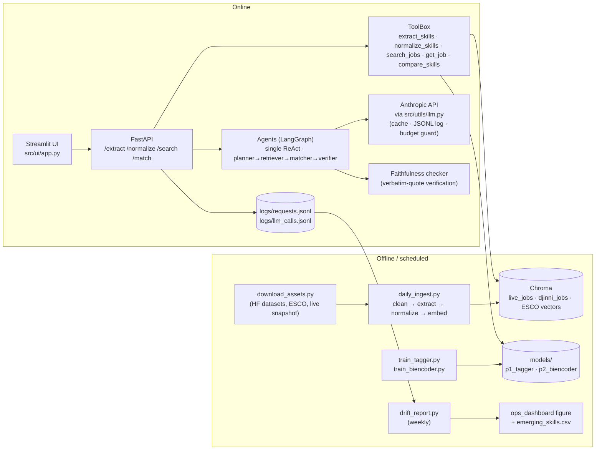

# Architecture and Model Ops

## 1. Deployment architecture

| Component | Choice | Notes |
|-----------|--------|-------|
| API service | FastAPI (`src/api/app.py`), Docker image (`Dockerfile`) | Loads the two taggers, the bi-encoder and the ESCO vectors once at startup; `/health` reports index sizes and the normalizer threshold. |
| LLM access | Anthropic Messages API behind `src/utils/llm.py` | Provider-swappable wrapper; every call is cached by (model, prompt version, input hash), logged with tokens/latency/cost, and refused once `llm.budget_usd` is spent. Model ids are verified against `GET /v1/models` at first use. |
| Retrieval | Chroma (persistent, cosine): `live_jobs`, `djinni_jobs`; ESCO skill vectors cached as a tensor next to the bi-encoder | Metadata: title, company, category, posted date, URL, ESCO skills, raw skills. Filters on category/remote/source. |
| Agent orchestration | LangGraph state graphs (`src/p3_agent/single_agent.py`, `multi_agent.py`) | Same five tools, same prompts directory, same model for both arms; short-term memory = the conversation and tool results of one request. |
| Ingestion | `src/monitoring/daily_ingest.py` → `src/index/build_job_index.py --pool live` | Idempotent upserts; a cron entry (`0 6 * * *`) keeps the demo on current postings. |
| UI | Streamlit (`src/ui/app.py`) | Paste a resume, pick single/multi/baseline, see ranked jobs with highlighted evidence, dropped claims and the agent trace. |
| Tracking | `train_summary.json` per model, `*.meta.json` next to every results table, `logs/llm_calls.jsonl` | Every number in the report traces to a file under `results/`. |

## 2. Maintenance plan

| Concern | What runs | Where |
|---------|-----------|-------|
| **Prompt versioning** | Prompts live in `prompts/*.yaml` with an explicit `version`; every LLM call logs `prompt_version`; a prompt change must re-run the fixed evaluation sets (`src/p1_extract/llm_extract.py`, `src/p2_normalize/run_workrb.py --models rtl`, `src/p3_agent/evaluate.py`) before merge. | `prompts/`, `logs/llm_calls.jsonl` |
| **Model updates** | Champion–challenger gate: a retrained tagger replaces `models/p1_tagger/*_seed42` only if dev strict F1 improves; a retrained bi-encoder replaces `models/p2_biencoder` only if WorkRB validation MAP and the labelled-set nDCG@10 do not regress. New seeds are additive. | `results/p1`, `results/p2`, `results/p3` |
| **Hallucination monitoring** | The faithfulness checker runs on every `/match` response; `logs/requests.jsonl` keeps the unsupported-claim rate per request; `drift_report.py` aggregates it per day and raises an alert above **2 %**. The multi-agent verifier removes unsupported claims before they reach the user. | `src/p3_agent/faithfulness.py`, `results/monitoring/drift_report.json` |
| **Drift monitoring** | Weekly: share of extracted phrases mapping to NOT_IN_ESCO (new skills), mean nearest-neighbour similarity of new postings to the tagger's training sentences, posting volume per category. Trend breaks trigger a labelling/retraining review. | `reports/figures/ops_dashboard.*` |
| **Human-in-the-loop** | Frequent NOT_IN_ESCO phrases land in `results/monitoring/emerging_skills.csv` (review queue); approved phrases are added to a custom skill list and become new training pairs for the bi-encoder. Thumbs up/down in the UI are logged with the request id and folded into the evaluation set. | `results/monitoring/`, `data/labels/` |
| **Data refresh** | ESCO 1.1.0 is pinned for evaluation (`configs/models.yaml`); the ESCO release is checked quarterly; the live snapshot is re-pulled daily. | `configs/`, `scripts/download_assets.py` |
| **Privacy** | `src/utils/pii.py` scrubs e-mails, phones, URLs and handles before any LLM call; raw posting text and CVs never enter git. | `.gitignore`, `src/utils/pii.py` |

## 3. Request flow (`POST /match`, multi-agent mode)

1. Resume text is PII-scrubbed.
2. **Planner** (LLM) → role family, seniority, target titles, must-have skills, 3–5 search queries.
3. **Retriever** (code) → `extract_skills` + `normalize_skills` on the resume, `search_jobs` per query, de-duplication, `get_job` + `compare_skills` for ~30 candidates.
4. **Matcher** (LLM) → ranked top-N with `fit_score`, matched/missing skills, verbatim quotes.
5. **Verifier** → deterministic quote check; flagged claims go to one LLM repair call per job; anything still unsupported is dropped and listed under `dropped`.
6. Faithfulness summary + usage (calls, tokens, cost, latency) are returned and logged.
